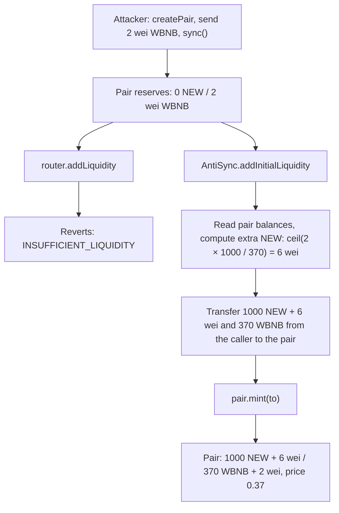

# anti-sync-v2

Adds the first liquidity to a Uniswap V2 / PancakeSwap pair at an exact price, even after someone has blocked the launch with a `sync()` attack.

[](https://github.com/catcatcat8/anti-sync-v2/actions/workflows/test.yml)
[](LICENSE)

## Overview

Anyone can create a Uniswap V2 pair for a token that has not launched yet. An attacker creates the pair, sends a few wei of WBNB to it and calls `sync()`. After that, every `router.addLiquidity` call for this pair reverts, and the team cannot launch the token.

`AntiSync` launches the pair anyway. It skips the router, sends the tokens straight to the pair and calls `pair.mint()`. It also adds a small extra amount to balance the attacker's tokens, so the launch price is exactly the one the team wanted. The attacker's tokens end up in the team's liquidity.

## The attack

A Uniswap V2 pair keeps two reserves. The price is their ratio. `sync()` is a public function that sets the reserves to the pair's current token balances.

1. Before the launch only the team has the new token (NEW). Anyone can get WBNB.
2. The attacker calls `factory.createPair(NEW, WBNB)`, sends 2 wei of WBNB to the pair and calls `sync()`. The reserves become **0 NEW / 2 wei WBNB**.
3. The team calls `router.addLiquidity(NEW, WBNB, ...)`. The pair is not empty, so the router fits the deposit to the current reserve ratio. To do that it calls `quote()`, which requires both reserves to be non-zero, and the transaction reverts with `INSUFFICIENT_LIQUIDITY`.

The attack costs 2 wei plus gas and works again for every new token.

Two obvious fixes do not work. Both are reproduced in [`test/Attack.t.sol`](test/Attack.t.sol):

- **Top up the dust and then call the router.** The team wants 1 NEW = 0.37 WBNB. To match 2 wei of WBNB it would need 5.4 wei of NEW, but only whole wei are possible. With 6 wei the dust ratio is 3:1 instead of 2.7:1. The router then fits the *whole* deposit to the dust ratio and launches the token at 0.333 WBNB instead of 0.37, about 10% lower.
- **Fix the dust in one transaction and add liquidity in the next.** Between the two transactions the pool holds only dust. A swap of 1000 wei moves its price anywhere, and `addLiquidity` either reverts on slippage limits or adds liquidity at the attacker's price.

## How AntiSync works



While a pair has no liquidity providers (`totalSupply() == 0`), `pair.mint()` accepts tokens in any ratio. Only the router checks the ratio. `AntiSync.addInitialLiquidity` does the following in one transaction:

1. Creates the pair if it does not exist.
2. Reverts if the pair already has liquidity providers. Extra tokens would be shared with them.
3. Reads the pair's token **balances**. It uses balances, not reserves, so tokens sent without `sync()` are counted too.
4. Computes the extra amount for one side so that the final balances have the ratio `amountA : amountB`. The extra amount is rounded up, so that side ends at most 1 wei above the exact value.
5. Checks the extra amounts against `maxExtraA` / `maxExtraB`.
6. Transfers `amount + extra` of each token from `msg.sender` directly to the pair and calls `pair.mint(to)`.

Every token in the pair belongs to the LP tokens minted to `to`, including the attacker's dust. The only exception is the `MINIMUM_LIQUIDITY` of 1000 wei, which every V2 pair locks on the first mint. The test `test_FrontRunDonationGoesToTheTeam` burns the LP tokens and gets back the deposit plus the attacker's WBNB.

`AntiSync` has no owner and no storage. Tokens never stay in it, so it gives no approvals to the router and has no leftovers to return. One deployment per chain is enough.

## Usage

```solidity
struct Params {
    IUniswapV2Factory factory; // Uniswap V2 factory or a fork (PancakeSwap, SushiSwap, ...)
    address tokenA;
    address tokenB;
    uint256 amountA;           // launch price = amountA / amountB
    uint256 amountB;
    uint256 maxExtraA;         // max tokenA to add on top of amountA to balance tokens already in the pair
    uint256 maxExtraB;         // max tokenB to add on top of amountB
    address to;                // receiver of the LP tokens
    uint256 deadline;          // the call reverts after this timestamp
}

function addInitialLiquidity(Params calldata params) external returns (address pair, uint256 liquidity);

function quoteExtra(IUniswapV2Factory factory, address tokenA, address tokenB, uint256 amountA, uint256 amountB)
    external view returns (uint256 extraA, uint256 extraB);
```

Launch sequence:

1. Call `quoteExtra` to see how much would be added right now. For dust it is a few wei.
2. Choose `maxExtraA` / `maxExtraB` with a margin. They are the front-running protection. If someone sends more tokens to the pair before your transaction and the extra amount goes above the limit, the call reverts with `ExtraAboveMax`. The tokens they sent stay in the pair and become yours on the next call.
3. Approve `AntiSync` for `amountA + maxExtraA` of `tokenA` and `amountB + maxExtraB` of `tokenB`.
4. Call `addInitialLiquidity`. After the launch, reset the unused part of the approvals.

Errors: `Expired`, `ZeroAmount`, `ZeroAddress` (`to`), `PairHasLiquidity`, `ExtraAboveMax(extraA, extraB)`. Event: `InitialLiquidityAdded(pair, sender, to, depositA, depositB, liquidity)`.

## Security considerations and limitations

- **Only the first liquidity.** If the pair already has LP tokens, the call reverts. An attacker can create LP tokens only if they hold some of the new token. Keep the token non-transferable for others until the launch.
- **`maxExtra` bounds the cost of front-running.** Inside the limits a front-run donation does not change the price and becomes part of your liquidity. Above the limits the call reverts.
- **Rounding.** The side that receives extra tokens ends at most 1 wei above the exact target ratio. The fuzz test `testFuzz_FinalPriceMatchesTarget` checks this for random prices and random synced or unsynced donations.
- **Fee-on-transfer and rebasing tokens are not supported.** The pair would receive less than the computed amount, and the price would be off.
- **Tokens with transfer restrictions** must allow a transfer from the caller to the pair, made by `AntiSync` as the spender.
- **V2 forks.** The contract relies on the original `mint()` logic. It is tested with the original Uniswap V2 bytecode (local tests) and with PancakeSwap V2 on BNB Smart Chain (fork tests). Forks with a modified `mint()` are not covered.
- **Uniswap V3 is out of scope.** It has a different attack: a pool initialized at a wrong `sqrtPriceX96`.
- The contract has not been audited.

## Getting started

Requirements: [Foundry](https://book.getfoundry.sh/getting-started/installation).

```bash
git clone --recursive https://github.com/catcatcat8/anti-sync-v2.git
cd anti-sync-v2
forge build
forge test
```

Example output:

```text
Ran 1 test for test/fork/AntiSyncFork.t.sol:AntiSyncForkTest
[SKIP: skipped: BSC_RPC_URL is not set] setUp()
Suite result: ok. 0 passed; 0 failed; 1 skipped

Ran 5 tests for test/Attack.t.sol:AttackTest
[PASS] test_AttackBreaksNormalLaunch()
[PASS] test_DustOnBothSidesForcesAttackerPrice()
[PASS] test_FixInSeparateTransactionIsGriefedAgain()
[PASS] test_NormalLaunchWithoutAttack()
[PASS] test_RouterCopiesRoundedDustRatio()
Suite result: ok. 5 passed; 0 failed; 0 skipped

Ran 14 tests for test/AntiSync.t.sol:AntiSyncTest
[PASS] testFuzz_FinalPriceMatchesTarget(uint256,uint256,uint256,uint256,bool) (runs: 256)
[PASS] test_AntiSyncRestoresTargetPrice()
[PASS] test_CountsTokensSentWithoutSync()
[PASS] test_CreatesPairIfMissing()
[PASS] test_DustOnBothSides()
[PASS] test_EmptyPairCreatedInAdvance()
[PASS] test_FrontRunDonationGoesToTheTeam()
[PASS] test_QuoteExtraWithoutPair()
[PASS] test_ReversedTokenOrder()
[PASS] test_RevertWhen_Expired()
[PASS] test_RevertWhen_ExtraAboveMax()
[PASS] test_RevertWhen_PairHasLiquidity()
[PASS] test_RevertWhen_ToIsZeroAddress()
[PASS] test_RevertWhen_ZeroAmount()
Suite result: ok. 14 passed; 0 failed; 0 skipped
```

Coverage of `src/AntiSync.sol` (`forge coverage`): 100% lines, statements, branches and functions.

**Fork tests** run the attack and the fix against the real PancakeSwap V2 contracts on BNB Smart Chain. Without `BSC_RPC_URL` they are skipped, which is why CI passes without secrets.

```bash
BSC_RPC_URL=<your BSC RPC URL> forge test --match-path 'test/fork/*' -vv
```

`BSC_FORK_BLOCK` pins the fork block (needs an archive node). Foundry also reads both variables from a `.env` file.

**Deploy:**

```bash
cast wallet import deployer --interactive   # once: store the key in an encrypted keystore
forge script script/Deploy.s.sol --rpc-url <RPC_URL> --account deployer --broadcast
```

## Project structure

```text
├── src
│   ├── AntiSync.sol                 # the contract
│   └── interfaces                   # minimal IUniswapV2Factory / IUniswapV2Pair
├── test
│   ├── Attack.t.sol                 # the attack and why router-based fixes fail
│   ├── AntiSync.t.sol               # unit, edge-case and fuzz tests
│   ├── fork/AntiSyncFork.t.sol      # PancakeSwap V2 on BNB Smart Chain
│   ├── fixtures                     # original Uniswap V2 factory and router bytecode
│   ├── mocks                        # MockERC20
│   └── utils                        # test setup and Uniswap V2 helpers
├── script/Deploy.s.sol
└── foundry.toml
```

## Context

A pet project: my own tool for token launches on PancakeSwap. The first version was a Hardhat project that topped up the dust, called `sync()` and then added liquidity through the router. While moving it to Foundry I found that the router-based approach can launch at a price that is off by about 10%, because the router copies the rounded dust ratio. The current version mints directly and comes with tests that reproduce the attack locally and on a BNB Smart Chain fork.

## License

[MIT](LICENSE)
