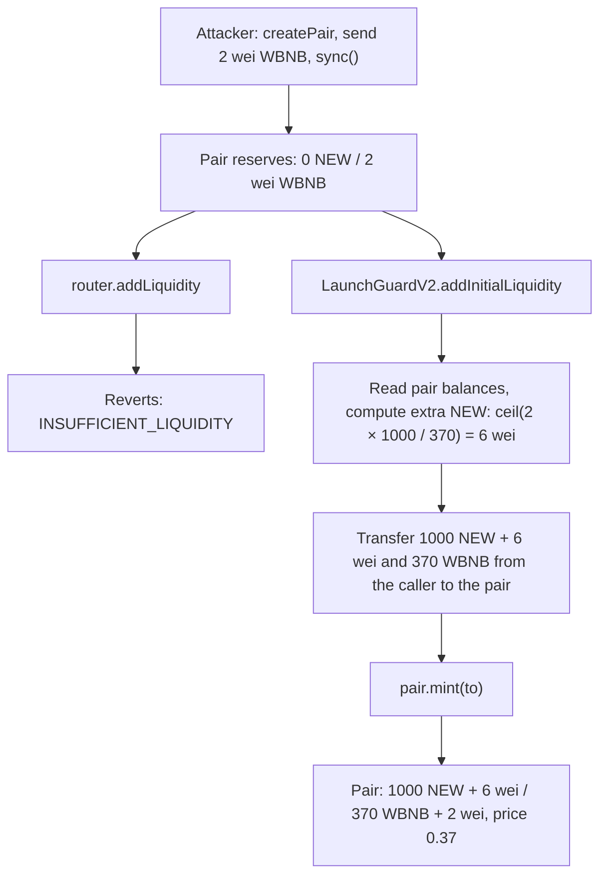
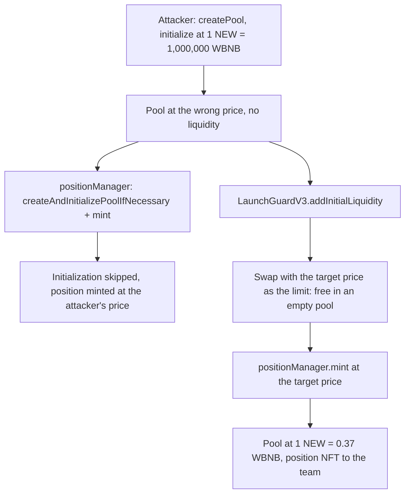

# amm-launch-guard

Launch a token on Uniswap V2 / V3 or PancakeSwap at the exact price you chose, even if an attacker has set up the pool first.

[](https://github.com/catcatcat8/amm-launch-guard/actions/workflows/test.yml)
[](LICENSE)

## Overview

Anyone can create the pool of a token before the token launches. An attacker can use this to block the launch or force a wrong starting price. On Uniswap V2 a few wei and `sync()` are enough. On Uniswap V3 the attacker initializes the pool at a wrong price. This repository has two contracts that still launch the pool at the exact target price, in one transaction:

| Contract | DEX | Attack |
|---|---|---|
| [`LaunchGuardV2`](src/LaunchGuardV2.sol) | Uniswap V2 and forks (PancakeSwap V2, SushiSwap, ...) | Dust + `sync()` makes `addLiquidity` revert or forces the dust ratio |
| [`LaunchGuardV3`](src/LaunchGuardV3.sol) | Uniswap V3, PancakeSwap V3 | The pool is initialized at a wrong price |

Both contracts have no owner and keep no tokens between calls. One deployment per chain serves any number of launches. Each attack is reproduced in a test against the original Uniswap bytecode and on a BNB Smart Chain fork.

The examples below launch a new token NEW against WBNB at 1 NEW = 0.37 WBNB (1000 NEW + 370 WBNB).

## Uniswap V2: the `sync()` attack

A Uniswap V2 pair keeps two reserves, and the price is their ratio. `sync()` is a public function that sets the reserves to the pair's current token balances.

1. Before the launch only the team has NEW. Anyone can get WBNB.
2. The attacker calls `factory.createPair(NEW, WBNB)`, sends 2 wei of WBNB to the pair and calls `sync()`. The reserves become **0 NEW / 2 wei WBNB**.
3. The team calls `router.addLiquidity`. The pair is not empty, so the router fits the deposit to the current reserve ratio. To do that it calls `quote()`, which requires both reserves to be non-zero, and the transaction reverts with `INSUFFICIENT_LIQUIDITY`.

The attack costs 2 wei plus gas. Two obvious fixes do not work. Both are reproduced in [`test/v2/AttackV2.t.sol`](test/v2/AttackV2.t.sol):

- **Top up the dust and then call the router.** To match 2 wei of WBNB at 0.37 the team would need 5.4 wei of NEW, but only whole wei are possible. With 6 wei the dust ratio is 3:1 instead of 2.7:1. The router then fits the *whole* deposit to the dust ratio and launches the token at 0.333 WBNB, about 10% lower.
- **Fix the dust in one transaction and add liquidity in the next.** Between the two transactions the pool holds only dust. In the test, a swap of 1000 wei of WBNB moves its price about 3000 times, and `addLiquidity` either reverts on slippage limits or adds liquidity at the attacker's price.

### How LaunchGuardV2 works



While a pair has no liquidity providers (`totalSupply() == 0`), `pair.mint()` accepts tokens in any ratio. Only the router checks the ratio. `addInitialLiquidity` skips the router:

1. Creates the pair if it does not exist.
2. Reverts if the pair already has liquidity providers. Extra tokens would be shared with them.
3. Reads the pair's token **balances**. It uses balances, not reserves, so tokens sent without `sync()` are counted too.
4. Computes the extra amount for one side so that the final balances have the ratio `amountA : amountB`. The extra amount is rounded up, so that side ends at most 1 wei above the exact value.
5. Checks the extra amounts against `maxExtraA` / `maxExtraB`.
6. Transfers `amount + extra` of each token from `msg.sender` directly to the pair and calls `pair.mint(to)`.

Every token in the pair, including the attacker's dust, belongs to the LP tokens minted to `to`. The only exception is the `MINIMUM_LIQUIDITY` of 1000 wei, which every V2 pair locks on the first mint. The test `test_FrontRunDonationGoesToTheTeam` burns the LP tokens and gets back the deposit plus the attacker's WBNB.

### Usage

```solidity
struct Params {
    IUniswapV2Factory factory; // Uniswap V2 factory or a fork
    address tokenA;
    address tokenB;
    uint256 amountA;           // launch price = amountA / amountB
    uint256 amountB;
    uint256 maxExtraA;         // max tokenA to add on top of amountA to balance tokens already in the pair
    uint256 maxExtraB;         // max tokenB to add on top of amountB
    address to;                // receiver of the LP tokens
    uint256 deadline;
}

function addInitialLiquidity(Params calldata params) external returns (address pair, uint256 liquidity);

function quoteExtra(IUniswapV2Factory factory, address tokenA, address tokenB, uint256 amountA, uint256 amountB)
    external view returns (uint256 extraA, uint256 extraB);
```

1. Call `quoteExtra` to see how much would be added right now. For dust it is a few wei.
2. Choose `maxExtraA` / `maxExtraB` with a margin. They are the front-running protection. If someone sends more tokens to the pair before your transaction and the extra amount goes above the limit, the call reverts with `ExtraAboveMax`. The tokens they sent stay in the pair and become yours on the next call.
3. Approve the guard for `amountA + maxExtraA` of `tokenA` and `amountB + maxExtraB` of `tokenB`.
4. Call `addInitialLiquidity`. After the launch, reset the unused part of the approvals.

Errors: `Expired`, `ZeroAmount`, `ZeroAddress`, `PairHasLiquidity`, `ExtraAboveMax`. Event: `InitialLiquidityAdded`.

## Uniswap V3: the initialization attack

A V3 pool stores its price as a separate value, `sqrtPriceX96`. Anyone can create a pool with `factory.createPool` and set its starting price with `pool.initialize`. `initialize` can be called only once.

1. The attacker creates the NEW/WBNB pool and initializes it at 1 NEW = 1,000,000 WBNB.
2. The team calls `positionManager.createAndInitializePoolIfNecessary(..., targetPrice)`. The pool is already initialized, so the call does nothing.
3. The team mints a position. It is created at the attacker's price: a full-range position takes all 370 WBNB and only 0.00037 NEW, and the pool keeps trading at the wrong price.

The fix uses a property of V3: while a pool has no liquidity, a swap moves the price to the requested limit and costs nothing, because there is nothing to trade against. But a free swap works for the attacker as well. If the team fixes the price in one transaction and mints in the next, the attacker can move the price back in between, also for free. Both cases are reproduced in [`test/v3/AttackV3.t.sol`](test/v3/AttackV3.t.sol).

### How LaunchGuardV3 works



`addInitialLiquidity` does the following in one transaction:

1. Calls `createAndInitializePoolIfNecessary` with the target price. If the pool did not exist or was not initialized, it is now at the target price.
2. If the pool price is elsewhere, swaps with the target price as `sqrtPriceLimitX96`. The swap stops exactly at the target.
3. Pulls `amount0Desired` / `amount1Desired` from the caller, mints the position through the position manager to `recipient`, and returns the unused tokens.

If the attacker has added liquidity to the pool, the swap has to trade against it. These trades happen at prices between the attacker's price and the target, so they are better for the caller than the target price. They still need tokens, and `maxSwapIn0` / `maxSwapIn1` cap how much the caller agrees to spend. The tokens received from the swap go to the caller. With no attacker liquidity the swap costs nothing, and the caps can stay at zero.

### Usage

```solidity
struct Params {
    INonfungiblePositionManager positionManager; // Uniswap V3 or PancakeSwap V3
    address token0;           // the token with the lower address
    address token1;
    uint24 fee;               // fee tier, for example 3000 for 0.3%
    uint160 sqrtPriceX96;     // target price: sqrt(token1 / token0) * 2^96
    int24 tickLower;          // position range, multiples of the tick spacing
    int24 tickUpper;
    uint256 amount0Desired;
    uint256 amount1Desired;
    uint256 amount0Min;
    uint256 amount1Min;
    uint256 maxSwapIn0;       // max token0 to spend on moving the price down to the target
    uint256 maxSwapIn1;       // max token1 to spend on moving the price up to the target
    address recipient;        // receiver of the position NFT
    uint256 deadline;
}

function addInitialLiquidity(Params calldata params)
    external returns (address pool, uint256 tokenId, uint128 liquidity, uint256 amount0, uint256 amount1);
```

1. Sort the tokens and compute `sqrtPriceX96 = sqrt(amount1 / amount0) × 2^96`. For a full-range launch use the widest ticks for the fee tier, for example ±887220 for tick spacing 60 (Uniswap 0.3%) or ±887250 for tick spacing 50 (PancakeSwap 0.25%).
2. Simulate the call (`eth_call`) to see whether moving the price costs anything. Set `maxSwapIn0` / `maxSwapIn1` with a margin.
3. Approve the guard for `amount0Desired + maxSwapIn0` of `token0` and `amount1Desired + maxSwapIn1` of `token1`.
4. Call `addInitialLiquidity`. After the launch, reset the unused part of the approvals.

Errors: `Expired`, `ZeroAddress`, `UnsortedTokens`, `SwapInAboveMax`, `PriceNotRestored`, `UnexpectedCallback`. Events: `PriceRestored`, `InitialPositionMinted`.

## Security considerations and limitations

Both contracts:

- **No owner and no stored funds.** Tokens move from `msg.sender` during the call only. A call can spend only the caller's own tokens, even if the caller passes a malicious factory, position manager or token. The test `test_FakePoolCannotSpendOtherApprovals` checks this for V3.
- **The limits are the front-running protection.** `maxExtra*` (V2) and `maxSwapIn*` (V3) bound how much an attacker can make you spend. Within the limits, a front-run does not change the launch price.
- **Fee-on-transfer and rebasing tokens are not supported.**
- **Tokens with transfer restrictions** must allow the transfers made by the guard as the spender.
- **The contracts have not been audited.**

`LaunchGuardV2`:

- **Only the first liquidity.** If the pair already has LP tokens, the call reverts. An attacker can create LP tokens only if they hold some of the new token, so keep the token non-transferable for others until the launch.
- **Rounding.** The side that receives extra tokens ends at most 1 wei above the exact ratio. The fuzz test `testFuzz_FinalPriceMatchesTarget` checks this for random prices and random synced or unsynced donations.
- It relies on the original V2 `mint()` logic. It is tested with the original Uniswap V2 bytecode and with PancakeSwap V2 on a fork. Forks with a modified `mint()` are not covered.

`LaunchGuardV3`:

- **The price is exact.** The swap uses the target as the price limit, and the fuzz test `testFuzz_RestoresAnyAttackerPrice` checks this for random attacker prices across the whole valid range.
- **The pool does not have to be empty.** Attacker liquidity is crossed at prices better than the target, within `maxSwapIn*`.
- **The swap callback trusts only the pool of the current call.** The payer is kept in transient storage and is always the caller. Re-entering `addInitialLiquidity` is blocked.
- **Gas.** The swap gas grows with the distance between the attacker's price and the target, and it is higher for fee tiers with a small tick spacing.
- **The target chain must support Cancun** (transient storage). Ethereum and BNB Smart Chain do.
- **Uniswap V4 is out of scope.**

## Getting started

Requirements: [Foundry](https://book.getfoundry.sh/getting-started/installation).

```bash
git clone --recursive https://github.com/catcatcat8/amm-launch-guard.git
cd amm-launch-guard
forge build
forge test
```

Example output (shortened):

```text
Ran 5 tests for test/v2/AttackV2.t.sol:AttackV2Test
[PASS] test_AttackBreaksNormalLaunch()
[PASS] test_DustOnBothSidesForcesAttackerPrice()
[PASS] test_FixInSeparateTransactionIsGriefedAgain()
[PASS] test_NormalLaunchWithoutAttack()
[PASS] test_RouterCopiesRoundedDustRatio()
Suite result: ok. 5 passed; 0 failed; 0 skipped

Ran 3 tests for test/v3/AttackV3.t.sol:AttackV3Test
[PASS] test_AttackKeepsWrongPrice()
[PASS] test_FixInSeparateTransactionIsGriefedAgain()
[PASS] test_NormalLaunchWithoutAttack()
Suite result: ok. 3 passed; 0 failed; 0 skipped

Ran 6 test suites: 38 tests passed, 0 failed, 2 skipped (40 total tests)
```

The two skipped suites are the fork tests. Coverage (`forge coverage`): 100% lines, statements, branches and functions for both `src/LaunchGuardV2.sol` and `src/LaunchGuardV3.sol`.

**Fork tests** run the attacks and the fixes against the real PancakeSwap V2 and V3 contracts on BNB Smart Chain. Without `BSC_RPC_URL` they are skipped, which is why CI passes without secrets.

```bash
cp .env.example .env   # set BSC_RPC_URL; Foundry reads .env automatically
forge test --match-path 'test/fork/*' -vv
```

`BSC_FORK_BLOCK` pins the fork block (needs an archive node).

**Deploy** both contracts:

```bash
cast wallet import deployer --interactive   # once: store the key in an encrypted keystore
forge script script/Deploy.s.sol --rpc-url <RPC_URL> --account deployer --broadcast
```

## Project structure

```text
├── src
│   ├── LaunchGuardV2.sol            # Uniswap V2 and forks
│   ├── LaunchGuardV3.sol            # Uniswap V3 and PancakeSwap V3
│   └── interfaces                   # minimal V2 / V3 interfaces
├── test
│   ├── v2                           # V2 attack, unit and fuzz tests
│   ├── v3                           # V3 attack, unit and fuzz tests
│   ├── fork                         # PancakeSwap V2 and V3 on BNB Smart Chain
│   ├── fixtures                     # original Uniswap V2 / V3 bytecode
│   ├── mocks                        # test tokens, a fake pool and position manager
│   └── utils                        # test setup and Uniswap helpers
├── script/Deploy.s.sol
└── foundry.toml
```

## Context

A personal project: a tool I wrote for my own token launches, kept here as a tested reference for both launch attacks and their fixes.

## License

[MIT](LICENSE)
